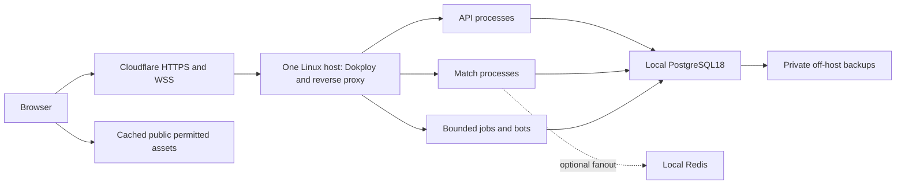

# BOOT-04: single-host reassessment after the Duels reference

> **Superseded research — historical evidence (correction note added 2026-10-10 UTC, [CHG-20261010-003](../changes/CHG-20261010-003.json)).** The finalized decisions are in the [BOOT-04 decision worksheet](2026-10-10-boot-04-decision-worksheet.md), [ADR0007](../adr/0007-hosting-provider-baseline.md) and [ADR0008](../adr/0008-engine-placement-dependency-baseline.md). Adopted from this research: the Director inputs (primarily North America; up to 50 concurrent invited-beta players), the remote-runtime prerequisite, the durable-authority/off-host-restore controls and the duels.ink observations. Not adopted: Hetzner CCX23/CCX33 (later out of stock and above the $25/month cap) and Dokploy (plain Docker Compose with pull-based deploys instead). Prices below are dated observations. The text below is unchanged.

Status: preferred **proposal**, not a selected provider or deployed architecture. Recorded 2026-10-08 UTC; raw source retrieval times and clock qualifications are in [source metadata](boot-04-single-host-sources.json). Director inputs remain North America, up to 50 concurrent beta players and a cost comparison before setting a ceiling. This proposal supersedes the initial hosting preference in [the October7 comparison](2026-10-07-boot-04-provider-research.md); that document and its prices remain dated research evidence.

The earlier default was too elaborate for this beta. A premium game and a large feature scope do not require separate hosting subscriptions for every application package. Prefer one well-sized Linux host with Dokploy, local PostgreSQL and bounded application processes. Keep Cloudflare in front and public assets/private backups in off-host storage. Add Redis for cross-worker fanout when multiple workers need it; consider PgBouncer when measured connection pressure warrants it. Neither needs to be installed into the current local foundation merely to match another site's stack. [ADR0007](../adr/0007-single-host-beta-proposal.md) records this proposed direction and alternatives.

## What was actually inspected

[Browser observations](../research/2026-10-08-duels-observations.json) distinguish direct observations, the Director's supplied developer account and inference. The tools reached a separate Linux Chrome149 session, initially signed out, rather than the Director's signed-in Codex browser. Windows computer-use failed with `sandboxCwd is not a local file URI`; authenticated inspection remains pending. No password, cookie, JWT value, private player data, raw HAR or third-party implementation was saved into this repository.

Inspected homepage/replay preview, card library and a card-detail dialog, puzzle listing, learning listing, loaded meta statistics, leaderboard, public/suggested/community deck listings, about/privacy and login. A self-created guest bot table allowed deck selection/readiness, starting a game, keeping the hand and ending a turn. The bot inked, played a character and returned the turn. Reload restored the visible turn 3 board/log/hand; the bot game was explicitly ended afterward. This is one ordinary client recovery observation, not proof of server-crash recovery, rules completeness or durable transaction boundaries. Puzzle execution requested sign-in. Saved decks, account history/settings, ranked/limited/cooperative flows and every card interaction were not tested.

Direct technical observations:

- React vendor identifies 19.3.0. Hashed TanStack/Radix chunks, query-client code, route imports and `/_serverFn/` requests are present. TanStack Start-style routing is an inference; exact build configuration/backend framework/version cannot be established from a public bundle.
- Cloudflare headers appear on documents/assets/API. Inspected JS assets use one-year immutable caching and returned cache HIT with zstd compression. Card images use a separate `cards.duels.ink` origin with thumbnail/full WebP variants. Split route assets and reuse of cached images reduce repeat work.
- Guest game console reported a connection to `wss://ws2.duels.ink/game/<id>`, then connected. Token endpoints, reconnect/resync code and a quiet-mulligan resync log were observed. The Network tool returned no WebSocket entries, so frame traffic was not captured. Separate socket hostnames do not prove separate physical servers or a worker count.
- The observed game board had zero canvas elements, card images and semantic controls; delivered code contains CSS perspective/rotation patterns. This does not certify accessibility or prove absence of other renderers. It does show that responsive tabletop interaction does not require a server GPU. Our authored Babylon/semantic-UI direction remains its own UX decision.
- Anonymous/guest account-only requests returned 401; intermittent `ERR_CONTENT_DECODING_FAILED` messages had no attributable request detail in these tools. Preserve these limited observations without presenting them as evidence of failed live gameplay. Successful guest socket connection and turn progression were observed separately.
- The root JS asset decoded to 6,657,340 bytes. That is uncompressed asset size, not transfer size. One initial uncontrolled navigation reported load 4.356s/DCL 1.605s; it is neither a representative performance benchmark nor the Director's Windows observation. Site counters and the Director's 300+ concurrency report are attributed reports, not independently verified load capacity.

The [published privacy policy](https://duels.ink/privacy), dated October2, names OVHcloud in Gravelines for app/Postgres/Redis, Hetzner in Nuremberg for replay/log/backup storage, and Cloudflare for card delivery. That policy is a site-published statement rather than host inspection. The supplied developer message recommends Hetzner hardware; it does not state that their live app runs there. The [about page](https://duels.ink/about) describes optional donation-related perks; our Director's policy remains that all cards/features/play are free. Reference observation does not adopt another project's monetization or establish our content rights.

## Proposed deployment and why it fits the whole vision

Keep `apps/web`, `apps/api`, `apps/match-service`, `apps/worker` and shared package authority/import boundaries. Build the web client as immutable static files; serve through the host/proxy/CDN, without exposing Vite. Start with one API process, one match process and one bounded worker class as a measurement fixture. Increase independent process replicas to use cores after testing real engine/bot work. The reported10 socket/5 HTTP worker counts and12-core/64GB host are another application's tuning, not our capacity requirement.

Decks, collection, packs, rewards, matchmaking, ranked, limited play, tutorials, chat/moderation and replay metadata can use the same PostgreSQL host with scoped tables/roles and transactional domain boundaries. Pack/tabletop rendering runs on the browser. Replays/assets/backups use storage rather than filling the database disk. Bots, deck analysis and simulation must have CPU/time/concurrency limits so they cannot monopolize live matches or builds. The original548 requirements/33 areas/20 optional flags, Collection Play/Lab/Advanced Sandbox distinctions and additional scope remain intact; the October7 full-scope mapping still applies. Their acceptance does not require physically distributed services by default.

The speed argument is sound but incomplete: local DB access removes a WAN hop between app and database; CPU/NVMe, query/index design, payload size, cached assets and client rendering also matter. Player-to-origin latency remains. More processes increase throughput across cores, while excessive replicas/pools/bots can compete for CPU, RAM, disk and DB connections. No50-player or300-player capacity claim is made for our unimplemented engine.

## The small set of controls to retain

1. **Durable authority.** Commit authoritative commands/receipts/economic changes before acknowledgement; one writer/serialization policy per match; rebuild authorized viewer state by revision after reconnect. [Redis Pub/Sub](https://redis.io/docs/latest/develop/pubsub/) can lose messages during disconnects. Use it for ephemeral fanout/wakeups, with durable truth and recovery in PostgreSQL. Environment database numbers do not isolate Pub/Sub channels; use separate instances or enforced environment prefixes.
2. **Bounded connections and work.** Node `pg` already pools connections. If adding [PgBouncer](https://www.pgbouncer.org/features.html), review session versus transaction pooling, prepared statements and session-dependent jobs. Transaction pooling does not support `LISTEN` or session advisory locks; use compatible/dedicated connections where needed. Statement pooling is unsuitable for multi-statement economic transactions. Budget connections across all replicas plus migrations/backup/admin access.
3. **Off-host restoration.** Scheduled game-DB backups with protected credentials/keys and one demonstrated restore onto a replacement host. Dokploy's [control-plane backup](https://docs.dokploy.com/docs/core/backups) saves its own database/config; configure [application-DB backups](https://docs.dokploy.com/docs/core/databases/backups) separately. A scheduled dump is not continuous WAL/PITR, and a RAID mirror is not a backup. Backup frequency and WAL archiving follow the Director's chosen recovery tolerance; daily dumps cannot support15-minute disaster recovery.
4. **Controlled releases and operations.** Build in existing CI and promote pinned images/releases; constrain same-host synthetic staging independently from beta DBs, credentials, buckets and workloads. Separate DB instances/hosts are not mandatory initially. Avoid builds/large restores on the live match CPU path. Protect Dokploy administrative access; expose HTTPS/WSS only, with PostgreSQL/Redis/pooler private. Retain health/backup-age/disk checks and an external availability alert; paid monitoring tiers are optional until required quotas/collaboration justify them. A named operator owns patching and restoration; Dokploy is deployment tooling, not a managed database operator.

[Cloudflare supports WebSockets on all plans](https://developers.cloudflare.com/network/websockets/), but proxy updates can disconnect them. Keepalive/reconnect/resync and server-side message validation are still application responsibilities. These controls implement existing correctness/recovery requirements; they do not imply multi-region or Kubernetes work now.

## Focused cost comparison

Fresh current advertised USD rates, before tax/domain/unknown usage. [Structured quantities](boot-04-single-host-costs.json) sum host, primary IPv4 and100GB total R2 storage with shared10GB free storage allowance once. This fixture assumes50GB public assets plus50GB private backups/replays and operations below free quotas; it does not measure our future catalog or retention. Host disks are included in the quoted configurations. No paid email/monitoring or separate always-on staging server is imposed; optional email upgrade adds$20/month if delivery limits require it.

| Candidate | Hardware / location | Known recurring subtotal | One-time setup |
|---|---|---:|---:|
| Hetzner CCX23 | 4 dedicated vCPU,16GB,160GB NVMe; Ashburn/Hillsboro | $104.94 | Not separately quoted |
| Hetzner CCX33 | 8 dedicated vCPU,32GB,240GB NVMe; Ashburn/Hillsboro | $167.94 | Not separately quoted |
| Hetzner AX42-1 | 8 physical cores,64GB ECC,2×512GB NVMe; Germany/Finland | $120.35 | $59 advertised |
| OVH Advance-3 2024 | 12 physical cores,64GB minimum; US-market bare metal candidate | $256.35 starting-price subtotal | $255 starting-price setup |

The Hetzner [June2026 revised rates](https://docs.hetzner.com/general/infrastructure-and-availability/price-adjustment/) are used, not cheaper pre-increase prices. [Primary IPv4](https://docs.hetzner.com/general/infrastructure-and-availability/ipv4-pricing/) is$0.60/month cloud/$1.90 dedicated. Hardware comes from the [CCX](https://www.hetzner.com/cloud/general-purpose/) and [AX42](https://www.hetzner.com/dedicated-rootserver/ax42/) pages. The [OVH US list](https://us.ovhcloud.com/bare-metal/advance/) is a starting-price signal; exact location/stock/options/IP/account terms require a configuration quote and may add charges. No auction/promotion assumed. These are known subtotals, not complete invoices, equivalent capacity or performance guarantees.

For North America, test one NA host first. Hetzner [US locations offer cloud, not dedicated root servers](https://docs.hetzner.com/cloud/general/locations/). A European bare-metal deal retains a cross-Atlantic game-command round trip even with Cloudflare. CCX23 is a reasonable qualification candidate; CCX33 adds headroom without imposing64GB as a beta floor. Compare actual NA bare-metal quotes if CPU-heavy bots or measured throughput justify them. Dynamic pages display availability ambiguously; stock/account eligibility is unconfirmed. Software/runtime versions, Dokploy distribution/license and pooler/Redis compatibility require qualification before installation; nothing is installed now.

The October7 $263.26 stage+beta fixture included separate always-on services/DBs and paid collaboration/email/monitoring assumptions. It remains a valid conditional worksheet, but is not our minimum bill. Larger/managed/high-availability alternatives remain available when operator burden or approved recovery targets warrant them. Single-host savings shift operating responsibility to us and put app/DB/Redis in one failure domain; choose that tradeoff deliberately.

## Current state and next decision

No application, dependency, local credentials/data, container topology, provider account or DNS change was made. Current executables still intentionally reject remote runtime. BOOT-04 remains in progress; this research revision does not accept staging, gameplay, capacity, recovery or real Windows/device requirements. [BOOT-04 validation](../validation/boot-04.md) records the fresh local baseline and documentation/source/arithmetic checks separately from browser research.

Next: Director reviews the one-host direction, chooses operator/recovery tolerance and budget/domain; obtain one final NA host quote. Then make provider-native definitions and remote runtime/image/secret/origin support reviewable before provisioning. Qualify the actual engine at50 concurrent players plus declared spectator/bot load, reload/process-loss behavior and off-host restore before accepting performance/recovery. Authenticated Duels inspection can continue when the signed-in test session is reachable; it is not a prerequisite for recommending this simpler topology.

Research timing qualification: four retrieved-source intervals show wall/monotonic discontinuity. Raw samples/body hashes remain unchanged and explicitly labeled; exact intervals are unqualified. This does not turn a retrieved page into failed runtime evidence or silently repair its timing. RUN-20261008-002 preserves a check-field error; corrected RUN-20261008-003 passes source/rate/arithmetic/scope/privacy assertions with consistent captured execution timing.
